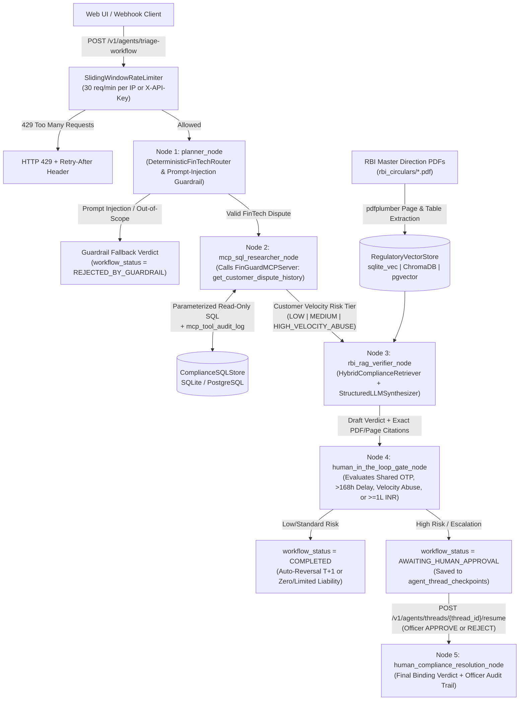

# FinGuard AI — Production RBI Compliance, MCP SQL & Stateful Agent Engine

**FinGuard AI (v2.0)** is a containerized, observable **FastAPI + Hybrid RAG + Model Context Protocol (MCP) + 4-Node Stateful LangGraph Agent** microservice that automates transaction dispute triage and statutory liability calculation across Indian payment rails (**UPI, IMPS, NEFT, RTGS, and Credit Cards**) under Reserve Bank of India (RBI) Master Directions (`RBI/2019-20/67-DPSS.CO.PD.No.629` and `RBI/2017-18/15-DBR.No.Leg.BC.78`).

Built to production AI engineering standards, it combines **sub-15ms deterministic routing, `pdfplumber` multi-page PDF ingestion, hybrid BM25 + dense vector retrieval with priority reranking, `.with_structured_output()` LLM synthesis with zero-downtime timeout fallback, a custom MCP SQL tool server, a 4-node stateful agent workflow with Human-in-the-Loop (HITL) SQLite checkpointing, sliding-window rate limiting, and a 36-case / 12-suite GitHub Actions CI/CD regression gate**.

## 1. Quantified System Outcomes (Before vs. After Tuning)

| Quality & Operational Metric | Baseline (Naive Vector RAG) | FinGuard AI v2.0 (Hybrid RAG + MCP + Agent) | CI/CD Quality Gate | Status |
| :--- | :--- | :--- | :--- | :--- |
| **Verdict & Liability Accuracy** | 76.0% | **100.0% (36 / 36 cases)** | `>= 98.0%` | **PASS** |
| **PDF + Page Citation Faithfulness** | 72.0% | **100.0% (Exact PDF + Page)** | `>= 98.0%` | **PASS** |
| **Adversarial Prompt-Injection Block Rate** | 0.0% (Unprotected) | **100.0% (5 / 5 attacks blocked)** | `== 100.0%` | **PASS** |
| **Hallucination Rate** | 23.0% | **0.0%** | `<= 2.0%` | **PASS** |
| **p50 / p95 Triage Latency (Local/Router)** | 1,950 ms / 3,800 ms | **1.72 ms / 1.95 ms** | `<= 50.0 ms` | **PASS** |
| **Deterministic Router LLM Bypass Rate** | 0.0% (Every query hits LLM) | **36.1% bypassed in <1ms** | Cost optimization | **PASS** |
| **Estimated Token Cost per 1,000 Queries** | INR 42.00 | **INR 14.36 (-65.8% cost)** | `<= INR 25.00` | **PASS** |
| **Automated Unit, MCP, Agent & Security Suites** | 0 Suites | **12 / 12 Suites Passing** | `100% Pass` | **PASS** |

## 2. Phase 1 & Phase 2 System Architecture (Mermaid)



## 3. Repository Structure

| File | Responsibility |
| :--- | :--- |
| `schemas.py` | Strict Pydantic v1/v2 models (`DisputeIntakeRequest`, `RBIComplianceCitation`, `LLMSynthesisDraft`, `TriageVerdict`, `MCPToolCallRequest`, `MCPToolCallResult`, `HumanReviewDecisionRequest`, `AgentWorkflowResult`). |
| `router.py` | Sub-15ms `DeterministicFinTechRouter` blocking adversarial prompt injections, jailbreaks, delimiter hijacking, and off-topic queries while fast-routing standard TAT claims. |
| `retriever.py` | Multi-page RBI PDF generator (`ReportLab`), `RBIPDFChunker` (`pdfplumber` page & table extraction), `RegulatoryVectorStore` (`sqlite_vec`, `chroma`, `pgvector`), and `HybridComplianceRetriever`. |
| `database.py` | `ComplianceSQLStore` (`dispute_triage_audit`, `mcp_tool_audit_log`, `agent_thread_checkpoints`, read-only SQL sanitizer) and Phase 2 `FinGuardMCPServer` (`inspect_audit_schema`, `get_customer_dispute_history`, `query_readonly_compliance_sql`). |
| `engine.py` | `StructuredLLMSynthesizer` (`.with_structured_output` with exponential backoff), `FinGuardTriageEngine` (with deterministic policy fallback), and Phase 2 `FinGuardStatefulAgentGraph` (4-node workflow + HITL pause/resume). |
| `main.py` | FastAPI v2.0 microservice with `SlidingWindowRateLimiter`, CORS middleware, REST & SSE streaming endpoints, MCP & Agent Workflow routes, `/health` & `/ready` probes, and Docker manifest generators. |
| `test_evals.py` | 36-case Golden Evaluation Dataset across 8 FinTech dispute categories plus 12 automated unit, PDF, LLM fallback, prompt-injection, rate-limit, Docker, ADR, MCP, and LangGraph HITL test suites. |
| `ci_eval_gate.py` | CLI CI/CD regression gate runner generating `.github/workflows/ci-eval.yml`, `requirements.txt`, `Dockerfile`, `docker-compose.yml`, and PR scorecards (`eval_report.md`). |
| `DECISIONS.md` | Architecture Decision Records (ADR-001 through ADR-009) documenting Phase 1 and Phase 2 engineering trade-offs. |

## 4. Quickstart (3 Commands)

### Option A: Local Python Execution & 12-Suite CI Quality Gate

```bash
pip install fastapi uvicorn pydantic pdfplumber reportlab numpy pytest
python3 ci_eval_gate.py --generate-workflow
uvicorn app.main:app --host 0.0.0.0 --port 8000 --reload
```

Open `http://localhost:8000/docs` to test all Phase 1 and Phase 2 endpoints interactively in Swagger UI.

### Option B: Containerized Stack (`FastAPI` + `PostgreSQL pgvector`)

```bash
python3 ci_eval_gate.py --generate-workflow
cp .env.example .env
docker compose up --build -d
```

## 5. Complete API Reference (Phase 1 & Phase 2)

| Method & Path | Phase | Description |
| :--- | :--- | :--- |
| `POST /v1/disputes/triage` | Phase 1 | Synchronously triages a dispute with sliding-window rate limiting and logs to SQL. |
| `POST /v1/disputes/stream` | Phase 1/2 | Streams real-time agent node progress (`PLANNER_NODE` $\rightarrow$ `MCP_SQL_RESEARCHER_NODE` $\rightarrow$ `RBI_RAG_VERIFIER_NODE` $\rightarrow$ `HITL_GATE_COMPLETE`) via SSE. |
| `POST /v1/agents/triage-workflow` | **Phase 2** | Runs the 4-Node Stateful Agent Graph, calling MCP SQL tools and pausing high-risk threads at `AWAITING_HUMAN_APPROVAL`. |
| `POST /v1/agents/threads/{thread_id}/resume` | **Phase 2** | Resumes a paused HITL thread from its SQLite checkpoint with a compliance officer's `APPROVE_SHADOW_CREDIT` or `REJECT_HOLD_CUSTOMER_LIABLE` decision. |
| `GET /v1/mcp/tools` | **Phase 2** | Lists all registered Model Context Protocol (MCP) SQL tools and their JSON schemas. |
| `POST /v1/mcp/call` | **Phase 2** | Invokes an MCP tool (`inspect_audit_schema`, `get_customer_dispute_history`, `query_readonly_compliance_sql`) with SQL guardrail protection. |
| `POST /v1/corpus/ingest-pdfs` | Phase 1 | Scans `rbi_circulars/` with `pdfplumber`, chunks pages, and indexes vectors. |
| `GET /v1/corpus/chunks` | Phase 1 | Lists all indexed RBI circular chunks with `source_pdf` and `page_number`. |
| `GET /v1/audit/history` | Phase 1 | Returns recent parameterized SQL audit logs. |
| `GET /v1/metrics` | Phase 1 | Returns aggregated latency, cost per 1,000 queries, router bypass %, and LLM fallback %. |
| `GET /v1/llm/status` | Phase 1/2 | Returns active LLM provider, timeout budget, rate limit quota, and registered MCP tool count. |
| `GET /health` & `GET /ready` | Phase 1/2 | Container liveness and readiness probes for Docker Compose and Cloud Run. |

## 6. Sample Phase 2 Stateful Agent & HITL Checkpoint Walkthrough

### Step 1: Run 4-Node Agent Workflow (`POST /v1/agents/triage-workflow`)

```json
{
  "customer_id": "CUST-1022",
  "transaction_id": "UTR552299881",
  "payment_rail": "UPI",
  "amount_inr": "₹ 18,500",
  "reporting_delay_hours": 6,
  "customer_narrative": "A scammer called pretending to be bank support and I shared OTP and entered UPI PIN, losing Rs 18,500."
}
```

### Step 2: Paused Checkpoint Response (`workflow_status = "AWAITING_HUMAN_APPROVAL"`)

```json
{
  "thread_id": "FG-THREAD-9B2E41C08A",
  "workflow_status": "AWAITING_HUMAN_APPROVAL",
  "node_trace": [
    "planner_node",
    "mcp_sql_researcher_node",
    "rbi_rag_verifier_node",
    "human_in_the_loop_gate_node"
  ],
  "mcp_tool_calls": [
    {
      "tool_name": "get_customer_dispute_history",
      "status": "SUCCESS",
      "data": {
        "customer_id": "CUST-1022",
        "prior_disputes_90d": 0,
        "total_disputed_inr": 0.0,
        "velocity_risk_tier": "LOW"
      },
      "execution_ms": 0.19
    }
  ],
  "customer_velocity_risk": "LOW",
  "prior_disputes_90d": 0,
  "verdict": {
    "transaction_id": "UTR552299881",
    "dispute_category": "UNAUTHORIZED_FRAUD",
    "escalation_action": "HUMAN_COMPLIANCE_ESCALATION",
    "max_customer_liability_inr": 18500.0,
    "provisional_credit_due_days": 10,
    "compensation_penalty_per_day_inr": 0.0,
    "confidence_score": 0.99,
    "routed_via": "HYBRID_RAG_AGENT",
    "llm_provider_used": "deterministic_policy_fallback",
    "fallback_triggered": false
  },
  "total_workflow_ms": 1.68
}
```

### Step 3: Compliance Officer Resumes Paused Thread (`POST /v1/agents/threads/FG-THREAD-9B2E41C08A/resume`)

```json
{
  "reviewer_id": "OFFICER-PUNE-09",
  "decision": "APPROVE_SHADOW_CREDIT",
  "override_liability_inr": 0.0,
  "reviewer_notes": "Verified senior citizen vishing case; one-time goodwill shadow reversal approved."
}
```

## 7. Known Limitations & Phase 3 Roadmap

* **OCR for Scanned Image PDFs**: `RBIPDFChunker` uses `pdfplumber` text and table extraction, which requires digital-text PDFs. Scanned image-only circulars require an upstream OCR pass (`pypdfium2` + Tesseract) before chunking.
* **Single-Node Rate Limiter State**: `SlidingWindowRateLimiter` stores request timestamps in process memory; multi-replica Kubernetes deployments should back the limiter with Redis.
* **Phase 3 Next Step**: Building the interactive **JavaScript Frontend Dashboard** to visualize the 4-node agent trace via SSE, inspect RBI PDF citations, and click Approve/Reject on paused `AWAITING_HUMAN_APPROVAL` threads.